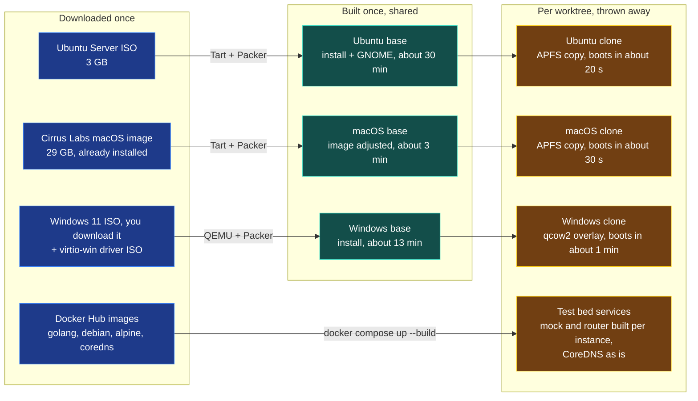
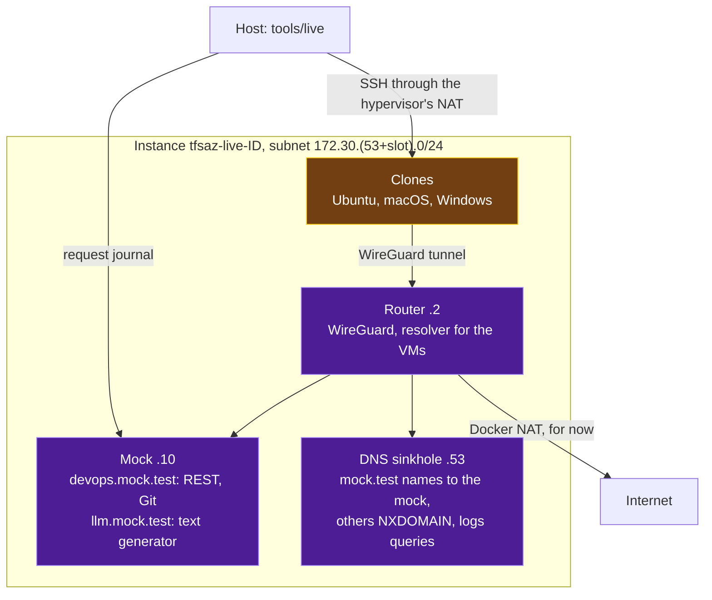
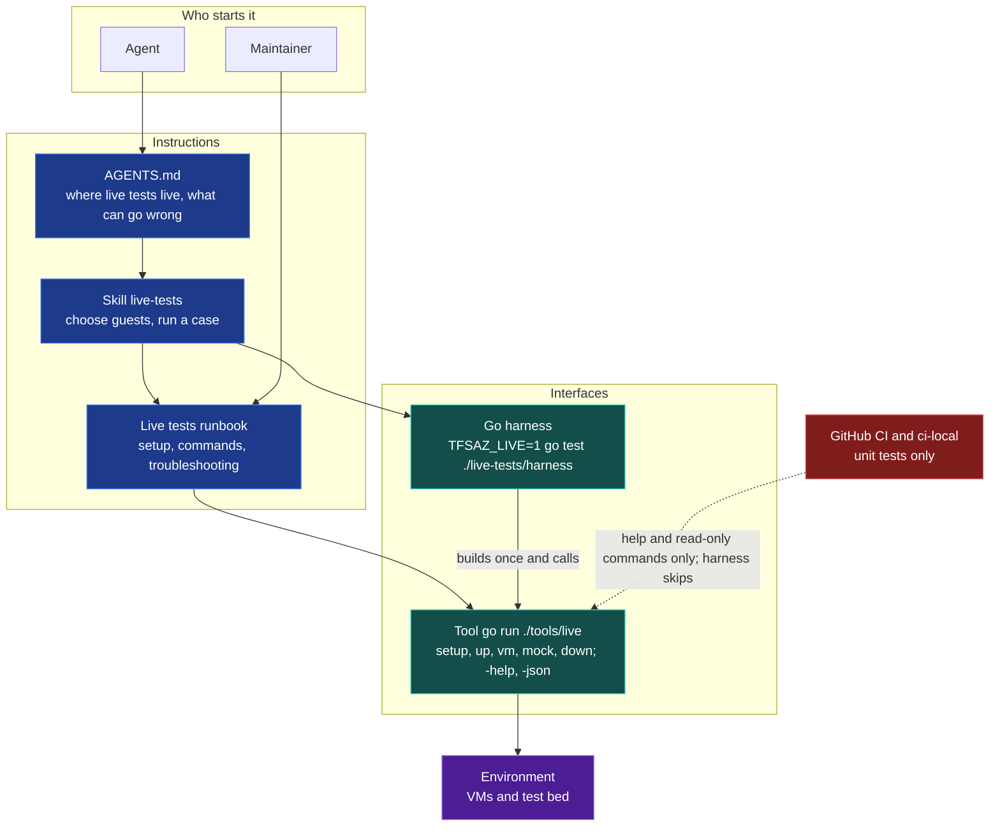

# Live tests overview

The big picture of the live-test toolchain: what it is made of, how it runs and how people and agents use it. The [runbook](live-tests.md) has the commands, the [internals](live-tests-internals.md) how the bases are built and what the tool keeps on the host.

The environment has two parts: VMs as test clients and a Docker test bed as the server side. Downloads are cached and the VM bases are built once; all worktrees share them. Each worktree then gets its own instance: its own clones and its own services, subnet and ports. Tart runs the Ubuntu and macOS VMs, QEMU the Windows VM, Packer drives every base build, and Docker Compose runs the test bed.

## Where everything comes from

The base builds also install SSH access, WireGuard and Chrome. No step installs TFSaz; a test installs it in its clone. The test bed has no shared build: each instance builds its mock and router images from Docker's layer cache and removes them on `down`.

Details: [Base VMs](live-tests-internals.md#base-vms) and [Clones](live-tests.md#clones).

## How it runs

At runtime, the clones reach the test bed only through a WireGuard tunnel to the router, like clients on a company network. The host reaches each clone over SSH through the hypervisor's NAT, and `tools/live` reads the mock's request journal. The mock's ports listen on the host's loopback only; the router's WireGuard port listens on all host interfaces, so the NATed guests reach it. Traffic to anything outside the test bed leaves through Docker's NAT, so the clones have internet access for now.

Details: [Worktrees and instances](live-tests.md#worktrees-and-instances), [Network](live-tests.md#network) and [DNS sinkhole](live-tests.md#dns-sinkhole).

## How it is used

Everything runs through one tool, `go run ./tools/live`. Maintainers call it directly; agents find it through AGENTS.md, which points to the `live-tests` skill, and the skill to the [runbook](live-tests.md). Automated cases use the Go harness, which builds the tool once and drives it. GitHub CI and `ci-local` only run the unit tests of both: the tool allows only help and read-only commands when `CI` or `GITHUB_ACTIONS` is set, and the harness skips its VM tests.

Details: [Write a live test](live-tests.md#write-a-live-test), [For agents](live-tests.md#for-agents) and the [`live-tests` skill](../../.agents/skills/live-tests/SKILL.md).

## What it covers today

The mock stands in for Azure DevOps Server 2022.2; checks against a real server use the shared testbed ([#33](https://github.com/toolspell/tfsaz/issues/33), [#47](https://github.com/toolspell/tfsaz/issues/47)). The smoke test runs on all three guests ([record](../verification/live-vm-smoke-2026-11.md)). Still open: the full test suite in each guest's desktop session ([#48](https://github.com/toolspell/tfsaz/issues/48)), browser trust on each OS ([#39](https://github.com/toolspell/tfsaz/issues/39)), external links from T3 on Windows ([#42](https://github.com/toolspell/tfsaz/issues/42)), offline runs and a fake agent for T3's agent threads.
